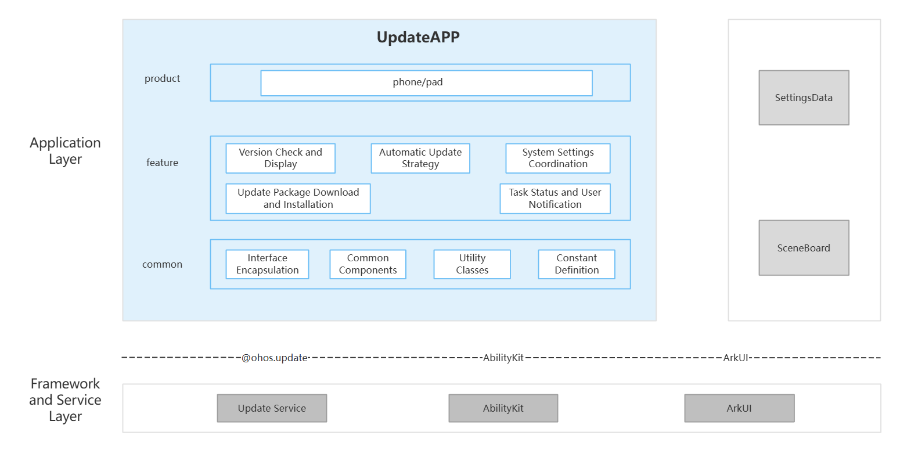

# UpdateApp

## Introduction

UpdateApp is a system application preinstalled in the OpenHarmony standard system. It supports version checking and display, automatic update policies, system settings integration, update package download and installation, and task status and user notifications. It is adapted for phone and tablet form factors.

### Main Capabilities

**Version Checking and Display**

- Manually checks for new versions and displays the version number, package size, and changelog.
- Queries information and release notes for the current version.
- Opens the home page, new version page, or current version page according to the check result.

**Automatic Update Policies**

- Provides an automatic download switch.
- Provides a nighttime installation switch. Enabling nighttime installation also enables automatic download.
- The default nighttime update window is defined as 02:00 to 04:00.

**System Settings Integration**

- Integrates the software update entry into system settings through `action.settings.menu.v1`.
- Writes the new-version badge and update phase to the SettingsData keys `hw_new_system_update` and `hw_new_system_update_status` for synchronized display by system settings and other consumers.

**Update Package Download and Installation**

- Starts update package downloads and displays downloading, paused, failed, verification, and completed states.
- Supports resuming downloads, canceling tasks, and controlling downloads according to Wi-Fi and other network conditions.
- Starts installation, application, or reboot-based updates according to the effective mode of the update package.

**Task Status and User Notifications**

- Subscribes to task events from Update Service and maps service states to page states.
- Publishes system notifications during download, installation, success, and failure phases.
- Uses SceneBoard to host `UpdateSystemDialogAbility` and display download reminders, installation reminders, and installation countdown dialogs.

## Architecture

UpdateApp uses a layered and modular design. Code is organized by product entry, feature capability, and common capability, as shown below.



### Application Layer Design

The application consists of a product layer, feature layer, and common layer:

| Layer | Main Directories / Components | Description |
|-------|-------------------------------|-------------|
| Product layer | `product/oh/base` | The `updateapp` Entry HAP, including the main Ability, pages, background ServiceExtension, and system-dialog UIExtension |
| Feature layer | `product/oh/base/src/main/ets/pages/`, `product/oh/base/src/main/ets/viewmodel/`, `product/oh/base/src/main/ets/UpdateSystemDialog/`, `feature/ota/` | Version checking and display, automatic update policies, system settings integration, update package download and installation, and task status and user notifications |
| Common layer | `common/src/main/ets/manager/`, `common/src/main/ets/component/`, `common/src/main/ets/util/`, `common/src/main/ets/const/` | API wrappers, common components, utility classes, and constant definitions |

**Feature layer capabilities:**

| Capability | Key Paths | Description |
|------------|-----------|-------------|
| Version checking and display | `product/oh/base/src/main/ets/pages/index.ets`, `product/oh/base/src/main/ets/pages/currentVersion.ets`, `product/oh/base/src/main/ets/pages/newVersion.ets`, `feature/ota/src/main/ets/OtaPage.ets`, `feature/ota/src/main/ets/util/ChangelogParseUtils.ets` | Uses `OtaUpdateManager` and `UpdateManager` to call version checking and version information APIs, and displays the version number, package size, and multilingual changelog |
| Automatic update policies | `product/oh/base/src/main/ets/pages/settingsView.ets`, `product/oh/base/src/main/ets/viewmodel/settingsViewModel.ets`, `feature/ota/src/main/ets/manager/OtaUpdateManager.ets` | Uses `getUpgradePolicy` / `setUpgradePolicy` to read and set automatic download and nighttime installation policies while maintaining switch dependencies |
| System settings integration | `feature/ota/src/main/ets/util/SettingsSyncUtils.ets`, `product/oh/base/src/main/module.json5` | Provides the software update entry through settings menu metadata and synchronizes the new-version badge and update phase to SettingsData |
| Update package download and installation | `product/oh/base/src/main/ets/pages/newVersion.ets`, `feature/ota/src/main/ets/manager/OtaUpdateManager.ets`, `feature/ota/src/main/ets/manager/StateManager.ets` | Uses `download` / `resumeDownload` / `cancel` / `upgrade` to start, resume, cancel, and install updates, and displays task progress and results |
| Task status and user notifications | `feature/ota/src/main/ets/manager/StateManager.ets`, `feature/ota/src/main/ets/notify/`, `feature/ota/src/main/ets/dialog/`, `product/oh/base/src/main/ets/UpdateSystemDialog/` | Subscribes to task events, maps page states, and displays update notifications and countdown dialogs through system notifications and the SceneBoard UIExtension |

**Common layer:**

| Directory / Component | Description |
|-----------------------|-------------|
| `common/src/main/ets/manager/` (**API wrappers**) | `UpdateManager` wraps the version query, download, installation, policy, and task event APIs from `@ohos.update`. `UpgradeInterface` defines the data interfaces used by pages and notifications |
| `common/src/main/ets/component/` (**Common components**) | Provides reusable ArkUI components such as the title bar, home card, settings options, and checking animation |
| `common/src/main/ets/util/` (**Utilities**) | Provides common utilities for network detection, device information, formatting, logging, and Ability launching |
| `common/src/main/ets/const/update_const.ts` (**Constants**) | Defines update states, error codes, notification actions, changelog models, package names, Ability names, and other shared data structures |

### Relationships with Other Components

UpdateApp works with **SettingsData**, **SceneBoard**, **Update Service**, **AbilityKit**, and **ArkUI** to synchronize software update states, display system dialogs, execute update tasks, and provide user interaction.

**Interaction methods:**

- SettingsData: UpdateApp writes `hw_new_system_update` and `hw_new_system_update_status` through `@ohos.settings` to synchronize the new-version badge and update phase.
- SceneBoard: UpdateApp connects to the system dialog service, and SceneBoard loads `UpdateSystemDialogAbility` to display download reminders, installation reminders, and installation countdown dialogs.
- Update Service: UpdateApp uses `@ohos.update` to check for versions, query and set policies, download and install update packages, and subscribe to task status events.
- AbilityKit: Provides lifecycle, connection, and launching capabilities for `MainAbility`, `ServiceExtAbility`, and `UpdateSystemDialogAbility`.
- ArkUI: Hosts the home page, version details, update settings, progress components, and system dialogs.

**External interfaces:**

| Interface Type | Identifier / Example | Description |
|----------------|----------------------|-------------|
| Application entry | `com.ohos.updateapp.MainAbility` | Provides the software update application entry. A specific page can be opened using the `uri` field in a Want, for example, `pages/newVersion` or `pages/settingsView` |
| Settings menu entry | `action.settings.menu.v1`, `metadata.settings.menu.v1` | Registers the software update menu entry with system settings |
| SettingsData items | `hw_new_system_update`, `hw_new_system_update_status` | Synchronize the new-version badge and update phase, respectively |
| Service extension entry | `ServiceExtAbility` | Receives startup or connection messages from Update Service and passes update task states to `OtaUpdateManager` |
| System dialog entry | `UpdateSystemDialogAbility` (`sysDialog/common`) | Loaded by SceneBoard. The `dialogType` parameter selects `downloadReminder`, `installReminder`, or `installCountdown` |

### Update Service and System Capability Integration

UpdateApp is responsible for interaction and presentation and does not implement the update engine. Online update operations are passed to Update Service through `@ohos.update`. Settings states are synchronized through `@ohos.settings`. System notifications and dialogs are provided by Notification Manager and SceneBoard, respectively.

**Call flow:**

```text
User action → Page / Component → OtaUpdateManager → UpdateManager → @ohos.update → Update Service → Updater / SysInstaller
```

**Capability and call flow mapping:**

| Capability | Call Flow | Main APIs / System Capabilities | Description |
|------------|-----------|--------------------------------|-------------|
| Version checking and display | Page → `OtaUpdateManager` → `UpdateManager` → `@ohos.update` | `checkNewVersion`, `getNewVersionInfo`, `getCurrentVersionInfo`, version description APIs | Queries the new and current versions and supplies the version number, package size, and changelog to pages |
| Automatic update policies | Settings page → `SettingsViewModel` → `OtaUpdateManager` → `@ohos.update` | `getUpgradePolicy`, `setUpgradePolicy` | Reads and sets automatic download and nighttime installation policies while maintaining switch dependencies |
| System settings integration | `module.json5` / `SettingsSyncUtils` → System settings | `action.settings.menu.v1`, `@ohos.settings` | Provides the software update entry and synchronizes the new-version badge and update phase |
| Update package download and installation | New version page → `OtaUpdateManager` → `UpdateManager` → `@ohos.update` | `download`, `resumeDownload`, `cancel`, `upgrade` | Starts, resumes, cancels, and installs update packages and receives task progress and results |
| Task status and user notifications | Update Service callback → `OtaUpdateManager` → `StateManager` → Notification / Dialog | `getTaskInfo`, `on`, `off`, Notification Manager, SceneBoard | Queries and subscribes to task states and displays update reminders through system notifications and the UIExtension |

## Building

This is a standalone HAP project built with Hvigor. The output is the `com.ohos.updateapp` system application.

### Environment Requirements

- OpenHarmony SDK: See `build-profile.json5`. The current `compileSdkVersion` is `26.0.0`, and both `compatibleSdkVersion` and `targetSdkVersion` are `23`.
- DevEco Studio or the Hvigor command-line toolchain.
- System application signing materials under `signature/`.
- A runtime system that provides `SystemCapability.Update.UpdateService` and `@ohos.update`.

### Build Command

Run the following command in the project root. `hvigorw` must be configured locally; alternatively, use DevEco Studio.

```bash
hvigorw assembleHap --mode module -p product=default -p debuggable=false -p buildMode=release
```

The signed release HAP is generated at:

```text
product/oh/base/build/default/outputs/release/updateapp-release-signed.hap
```

## Developing UpdateApp

UpdateApp is developed in **ArkTS**, with its UI based on the ArkUI Stage model. `com.ohos.updateapp.MainAbility` hosts the main UI, while `OtaUpdateManager` under `feature/ota/` coordinates version checking, update policies, update package download and installation, and task status processing. For details, see [ArkUI Development Overview](https://gitcode.com/openharmony/docs/blob/master/en/application-dev/ui/arkts-ui-development-overview.md).

### Developing Based on Existing Modules

Use this approach to customize existing UpdateApp capabilities, such as version checking and display, automatic update policies, system settings integration, update package download and installation, or task status and user notifications.

The following are common modification scenarios:

**Scenario 1: Customizing Version Checking and Display**

- Page entries: `product/oh/base/src/main/ets/pages/index.ets`, `product/oh/base/src/main/ets/pages/currentVersion.ets`, `product/oh/base/src/main/ets/pages/newVersion.ets`
- Service entry: `feature/ota/src/main/ets/manager/OtaUpdateManager.ets`
- Page data and changelog: `feature/ota/src/main/ets/OtaPage.ets`, `feature/ota/src/main/ets/util/ChangelogParseUtils.ets`

`OtaUpdateManager` uses `UpdateManager` to call version checking, current and new version information, and version description APIs. The pages display the version number, package size, and multilingual changelog. When changing check results or display content, verify the home, current version, and new version pages together.

```typescript
const result = await OtaUpdateManager.getInstance().checkNewVersion();
if (result.callResult === UpgradeCallResult.OK && result.data?.isExistNewVersion) {
  // Extension point: customize how new-version information is displayed.
}
```

**Scenario 2: Customizing Automatic Update Policies**

- Settings page: `product/oh/base/src/main/ets/pages/settingsView.ets`
- Policy model: `product/oh/base/src/main/ets/viewmodel/settingsViewModel.ets`
- API entry: `feature/ota/src/main/ets/manager/OtaUpdateManager.ets`

The settings page uses `getUpgradePolicy` / `setUpgradePolicy` to read and set automatic download and nighttime installation policies. Nighttime installation depends on automatic download, so preserve the dependency between these switches when modifying the policy.

```typescript
const policy = await OtaUpdateManager.getInstance().getUpdatePolicy();
policy.autoUpgradeStrategy = true;
policy.downloadStrategy = true; // Enabling nighttime installation also enables automatic download.
await OtaUpdateManager.getInstance().setUpdatePolicy(policy);
```

**Scenario 3: Customizing System Settings Integration**

- Settings entry: `action.settings.menu.v1` in `product/oh/base/src/main/module.json5`
- State synchronization: `feature/ota/src/main/ets/util/SettingsSyncUtils.ets`
- SettingsData keys: `hw_new_system_update`, `hw_new_system_update_status`

System settings displays the software update entry through menu metadata. UpdateApp uses `SettingsSyncUtils` to synchronize the new-version badge and update phase. When adding a state, add the corresponding mapping agreed with the settings side to `mapStatus`.

```typescript
// Synchronize SettingsData after a version check or task state change.
SettingsSyncUtils.syncCheckResult(true, context);
SettingsSyncUtils.syncFromOtaStatus(otaStatus, context);
```

**Scenario 4: Customizing Update Package Download and Installation**

- Page entry: `product/oh/base/src/main/ets/pages/newVersion.ets`
- Service entry: `feature/ota/src/main/ets/manager/OtaUpdateManager.ets`
- State handling: `feature/ota/src/main/ets/manager/StateManager.ets`

`OtaUpdateManager` uses `UpdateManager` to call `download`, `resumeDownload`, `cancel`, and `upgrade`, and passes callback states to `StateManager`. When modifying the download or installation flow, verify network conditions, task progress, failure handling, and page results together.

```typescript
const manager = OtaUpdateManager.getInstance();
await manager.download();
// Start installation according to the page state after the download completes.
await manager.upgrade(update.Order.INSTALL_AND_APPLY);
```

**Scenario 5: Customizing Task Status and User Notifications**

- State machine: `feature/ota/src/main/ets/manager/StateManager.ets`
- System notifications: `feature/ota/src/main/ets/notify/`
- System dialogs: `feature/ota/src/main/ets/notify/SceneBoardDialogManager.ets`, `product/oh/base/src/main/ets/UpdateSystemDialog/`

UpdateApp uses `getTaskInfo`, `on`, and `off` to query and subscribe to task states. `StateManager` maps these states to page behavior. To notify the user, publish a notification through Notification Manager or use SceneBoard to load `UpdateSystemDialogAbility` and display download, installation, or countdown dialogs.

```typescript
OtaUpdateManager.getInstance().on();
await SceneBoardDialogManager.showDialog(context, {
  dialogType: SceneBoardDialogType.DOWNLOAD_REMINDER
});
// Call OtaUpdateManager.getInstance().off() when the Ability exits.
```

Common modification entries:

| Target | Path |
|--------|------|
| Version checking and display | `product/oh/base/src/main/ets/pages/`, `feature/ota/src/main/ets/OtaPage.ets`, `feature/ota/src/main/ets/util/ChangelogParseUtils.ets` |
| Automatic update policies | `product/oh/base/src/main/ets/pages/settingsView.ets`, `product/oh/base/src/main/ets/viewmodel/settingsViewModel.ets` |
| System settings integration | `feature/ota/src/main/ets/util/SettingsSyncUtils.ets`, `product/oh/base/src/main/module.json5` |
| Update package download and installation | `product/oh/base/src/main/ets/pages/newVersion.ets`, `feature/ota/src/main/ets/manager/OtaUpdateManager.ets` |
| Task status and user notifications | `feature/ota/src/main/ets/manager/StateManager.ets`, `feature/ota/src/main/ets/notify/`, `feature/ota/src/main/ets/dialog/`, `product/oh/base/src/main/ets/UpdateSystemDialog/` |
| Application lifecycle and route restoration | `product/oh/base/src/main/ets/MainAbility/MainAbility.ets` |
| Background task hosting | `product/oh/base/src/main/ets/ServiceExtAbility/` |
| Ability, extension, and permission declarations | `product/oh/base/src/main/module.json5` |
| Page route registration | `product/oh/base/src/main/resources/base/profile/main_pages.json` |

### Developing New Capabilities

When adding an OTA interaction capability, place the implementation according to the following boundaries:

1. Put product pages, Abilities, and device-specific differences under `product/oh/base`.
2. Put OTA business rules, state machines, notifications, and dialogs under `feature/ota`.
3. Put API wrappers, common components, utilities, and constants under `common/src/main/ets/manager/`, `common/src/main/ets/component/`, `common/src/main/ets/util/`, and `common/src/main/ets/const/`, respectively.
4. Register a new page in `main_pages.json`. Declare new Abilities or permissions in `module.json5`.
5. For a new Update Service API, extend `IUpdate` / `UpdateManager` first, and then coordinate it through `OtaUpdateManager` instead of allowing a page to hold the underlying Updater directly.
6. When adding a service state, check the page, notification, system dialog, and SettingsData presentation paths together.

For example, to add an update status entry, read the existing task state in a feature-layer component and reuse the existing route to open the new version page:

```typescript
@Component
export struct UpgradeStatusEntry {
  @StorageProp('updateStatus')
  private updateStatus: number = AppStorage.Get('updateStatus') as number;

  build() {
    Button($r('app.string.title_new_version'))
      .enabled(this.updateStatus !== UpdateState.INIT)
      .onClick(() => RouterUtils.openNewVersionPage());
  }
}
```

Place the component under `feature/ota/src/main/ets/components/` and reference it from a page under `product/oh/base`. If it is implemented as a standalone page, also register its route in `main_pages.json`.

## Directory Structure

```text
update_app
├─AppScope                                      # App-level configuration, icons, and localized resources
│  ├─app.json5                                  # Bundle name, version, and other application information
│  └─resources/                                 # Application icons, name, and localized resources
├─product/oh/base                               # UpdateApp Entry HAP for phone and tablet form factors
│  └─src/main/
│     ├─ets/                                    # Product entries, pages, policy models, and extensions
│     │  ├─Application/                         # AbilityStage initialization and global context
│     │  ├─MainAbility/                         # Main UI, Want routing, and task event subscription
│     │  ├─pages/                               # Version checking, current/new version display, download, installation, and automatic update settings
│     │  ├─viewmodel/                           # Update policy reading, writing, and switch dependencies
│     │  ├─ServiceExtAbility/                   # Update Service messages, remote task states, and notification actions
│     │  └─UpdateSystemDialog/                  # System-dialog UIExtension for download, installation, and countdown reminders
│     ├─resources/                              # Product page styles and page route configuration
│     └─module.json5                            # MainAbility, extensions, settings entry, and permission declarations
├─feature/ota                                   # OTA feature HAR
│  └─src/main/
│     ├─ets/                                    # OTA page data adaptation, notification capabilities, and service implementation
│     │  ├─manager/                             # Version checking, update policies, download/installation coordination, and task state mapping
│     │  ├─notify/                              # State notification publishing, notification actions, and SceneBoard dialog connection
│     │  ├─dialog/                              # Network confirmation, download cancellation, automatic update, and countdown dialogs
│     │  ├─components/                          # Version number, package size, changelog, and task progress components
│     │  └─util/                                # SettingsData synchronization, routing, version, and changelog processing
│     └─resources/                              # OTA strings, colors, dimensions, and icons
├─common                                        # Common HAR
│  └─src/main/
│     ├─ets/
│     │  ├─manager/                             # @ohos.update wrappers and page/notification interfaces
│     │  ├─component/                           # Title bar, home card, settings options, and checking animation
│     │  ├─util/                                # Network, device, formatting, logging, and Ability utilities
│     │  └─const/                               # Update states, error codes, notification actions, and common constants
│     └─resources/                              # Common component styles, images, videos, and localized resources
├─signature                                     # System application signing materials
├─hvigor                                        # Hvigor build configuration
├─build-profile.json5                           # Project product, SDK, and signing configuration
├─oh-package.json5                              # Project dependency configuration
├─OAT.xml                                       # Open-source compliance audit
├─LICENSE
├─README.md                                     # English documentation
└─README_zh.md                                  # Chinese documentation
```

## Constraints

- **Language and UI model**: ArkTS and the ArkUI Stage model.
- **Runtime form**: A preinstalled system HAP with bundle name `com.ohos.updateapp`. A normal third-party application cannot replace this runtime form.
- **Device types**: Default devices and tablets, as declared in `product/oh/base/src/main/module.json5`.
- **Signing**: A system application signing profile is required. See `signature/updateapp.p7b`.
- **System capabilities**: Depends on `SystemCapability.Update.UpdateService`, SettingsData, SceneBoard, and the notification service.
- **Update boundary**: This repository does not contain Update Service, update package generation, server-side publishing, or the Updater installation implementation.

Main permissions:

| Permission | Grant Mode | Usage |
|------------|------------|-------|
| `ohos.permission.UPDATE_SYSTEM` | System grant | Calls system update APIs to check, download, and install update packages |
| `ohos.permission.GET_NETWORK_INFO` | System grant | Checks network availability and network type before and during downloads |
| `ohos.permission.START_ABILITIES_FROM_BACKGROUND` | System grant | Opens update pages from background services or notification scenarios |
| `ohos.permission.MANAGE_SECURE_SETTINGS` | System grant | Writes software update badges, phases, and other system settings items |
| `ohos.permission.START_SYSTEM_DIALOG` | System grant | Displays update system dialogs through SceneBoard |

## Contributing

Contributions to code and documentation are welcome. For details, see the [OpenHarmony contribution guide](https://gitcode.com/openharmony/docs/blob/master/en/contribute/how-to-contribute.md).

## Related Repositories

[**update_updateservice**](https://gitcode.com/openharmony/update_update_service)

[**update_updater**](https://gitcode.com/openharmony/update_updater)

[**update_packaging_tools**](https://gitcode.com/openharmony/update_packaging_tools)

