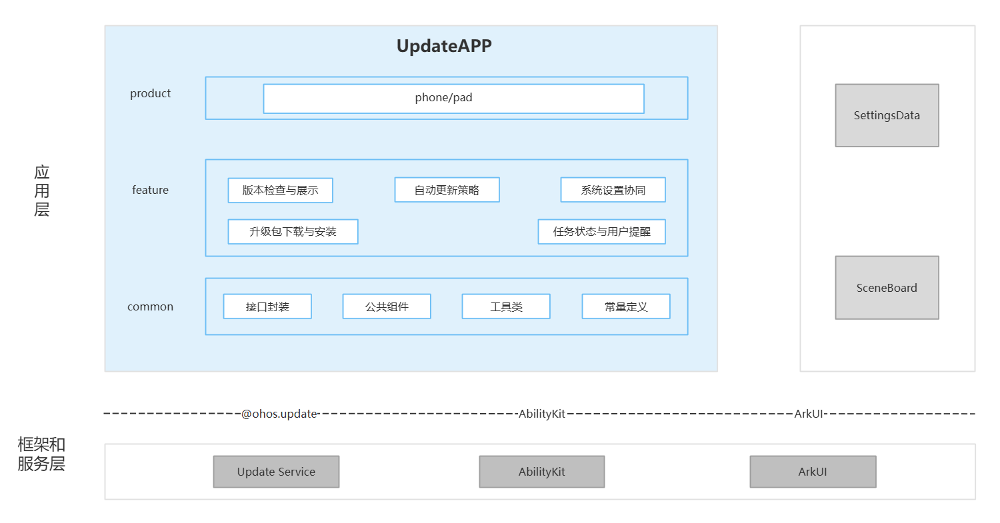

# UpdateApp

## 简介

UpdateApp 是 OpenHarmony 标准系统中预置的系统应用，支持版本检查与展示、自动更新策略、系统设置协同、升级包下载与安装、任务状态与用户提醒等能力，适配手机、平板设备形态。

### 主要能力

**版本检查与展示**

- 手动检查新版本，展示版本号、包大小与更新日志。
- 查询当前版本信息和当前版本说明。
- 根据是否存在新版本跳转首页、版本详情页或当前版本页。

**自动更新策略**

- 支持自动下载开关。
- 支持夜间安装开关；开启夜间安装时同步开启自动下载。
- 默认夜间升级时间段由页面常量定义为 02:00 至 04:00。

**系统设置协同**

- 通过 `action.settings.menu.v1` 接入系统设置的软件更新入口。
- 将新版本角标与升级阶段写入 SettingsData 的 `hw_new_system_update`、`hw_new_system_update_status`，供系统设置等消费方同步展示。

**升级包下载与安装**

- 发起升级包下载，展示下载、暂停、失败、校验和完成等状态。
- 支持恢复下载、取消任务以及 Wi-Fi 等网络条件控制。
- 根据升级包的生效模式发起安装、应用或重启升级。

**任务状态与用户提醒**

- 订阅 Update Service 的任务事件，并将服务状态转换为页面状态。
- 在下载、安装、成功或失败等阶段发布系统通知。
- 通过 SceneBoard 承载 `UpdateSystemDialogAbility`，展示下载提醒、安装提醒和安装倒计时系统弹窗。

## 架构说明

UpdateApp 采用分层与模块化设计，按产品入口、业务特性与公共能力组织代码，如图：



### 应用层分层设计

整体可划分为产品层、特性层、公共层：

| 层次 | 主要目录 / 组件 | 说明 |
|------|-----------------|------|
| 产品层 | `product/oh/base` | `updateapp` Entry HAP；包含主 Ability、页面、后台 ServiceExtension 与系统弹窗 UIExtension |
| 特性层 | `product/oh/base/src/main/ets/pages/`、`product/oh/base/src/main/ets/viewmodel/`、`product/oh/base/src/main/ets/UpdateSystemDialog/`、`feature/ota/` | 版本检查与展示、自动更新策略、系统设置协同、升级包下载与安装、任务状态与用户提醒 |
| 公共层 | `common/src/main/ets/manager/`、`common/src/main/ets/component/`、`common/src/main/ets/util/`、`common/src/main/ets/const/` | 接口封装、公共组件、工具类、常量定义 |

**特性层能力说明**：

| 主要能力 | 关键路径 | 说明 |
|----------|----------|------|
| 版本检查与展示 | `product/oh/base/src/main/ets/pages/index.ets`、`product/oh/base/src/main/ets/pages/currentVersion.ets`、`product/oh/base/src/main/ets/pages/newVersion.ets`、`feature/ota/src/main/ets/OtaPage.ets`、`feature/ota/src/main/ets/util/ChangelogParseUtils.ets` | 经 `OtaUpdateManager`、`UpdateManager` 调用版本检查及版本信息接口，展示版本号、包大小和多语言更新日志 |
| 自动更新策略 | `product/oh/base/src/main/ets/pages/settingsView.ets`、`product/oh/base/src/main/ets/viewmodel/settingsViewModel.ets`、`feature/ota/src/main/ets/manager/OtaUpdateManager.ets` | 经 `getUpgradePolicy` / `setUpgradePolicy` 读取和设置自动下载、夜间安装策略，并保持开关联动 |
| 系统设置协同 | `feature/ota/src/main/ets/util/SettingsSyncUtils.ets`、`product/oh/base/src/main/module.json5` | 通过设置菜单元数据提供软件更新入口，并向 SettingsData 同步新版本角标和升级阶段 |
| 升级包下载与安装 | `product/oh/base/src/main/ets/pages/newVersion.ets`、`feature/ota/src/main/ets/manager/OtaUpdateManager.ets`、`feature/ota/src/main/ets/manager/StateManager.ets` | 经 `download` / `resumeDownload` / `cancel` / `upgrade` 发起下载、恢复、取消和安装，并展示任务进度与结果 |
| 任务状态与用户提醒 | `feature/ota/src/main/ets/manager/StateManager.ets`、`feature/ota/src/main/ets/notify/`、`feature/ota/src/main/ets/dialog/`、`product/oh/base/src/main/ets/UpdateSystemDialog/` | 订阅任务事件并映射页面状态，通过系统通知和 SceneBoard UIExtension 展示升级提醒与倒计时弹窗 |

**公共层说明**：

| 目录 / 组件 | 说明 |
|-------------|------|
| `common/src/main/ets/manager/`（**接口封装**） | `UpdateManager` 封装 `@ohos.update` 的版本查询、下载、安装、策略和任务事件接口；`UpgradeInterface` 定义页面与通知使用的数据接口 |
| `common/src/main/ets/component/`（**公共组件**） | 提供标题栏、首页卡片、设置选项和检查动画等可复用 ArkUI 组件 |
| `common/src/main/ets/util/`（**工具类**） | 提供网络判断、设备信息、格式化、日志及 Ability 拉起等通用工具，支撑各升级页面和任务流程 |
| `common/src/main/ets/const/update_const.ts`（**常量定义**） | 定义升级状态、错误码、通知动作、更新日志模型、包名和 Ability 名等公共常量与数据结构 |

### 与其它部件的关系

UpdateApp 与 **SettingsData**、**SceneBoard**、**Update Service**、**AbilityKit** 和 **ArkUI** 协同，完成软件更新状态同步、系统弹窗展示、升级任务执行及用户界面交互。

**调用方式**：

- SettingsData：应用通过 `@ohos.settings` 写入 `hw_new_system_update`、`hw_new_system_update_status`，同步新版本角标和升级阶段。
- SceneBoard：应用连接系统弹窗服务，由 SceneBoard 加载 `UpdateSystemDialogAbility`，展示下载提醒、安装提醒和安装倒计时弹窗。
- Update Service：应用通过 `@ohos.update` 发起版本检查、策略查询与设置、升级包下载和安装，并订阅任务状态事件。
- AbilityKit：提供 `MainAbility`、`ServiceExtAbility`、`UpdateSystemDialogAbility` 等 Ability 的生命周期、连接和拉起能力。
- ArkUI：承载首页、版本详情、更新设置、进度组件和系统弹窗等界面。

**对外接口**：

| 接口类型 | 接口标识 / 示例 | 说明 |
|----------|-----------------|------|
| 应用入口 | `com.ohos.updateapp.MainAbility` | 提供软件更新应用入口；可通过 Want 的 `uri` 参数打开指定页面，例如 `pages/newVersion`、`pages/settingsView` |
| 设置菜单入口 | `action.settings.menu.v1`、`metadata.settings.menu.v1` | 向系统设置注册软件更新菜单入口 |
| SettingsData 数据项 | `hw_new_system_update`、`hw_new_system_update_status` | 分别用于同步新版本角标和升级阶段 |
| 服务扩展入口 | `ServiceExtAbility` | 接收 Update Service 的启动或连接消息，并交由 `OtaUpdateManager` 处理升级任务状态 |
| 系统弹窗入口 | `UpdateSystemDialogAbility`（`sysDialog/common`） | 供 SceneBoard 加载；通过 `dialogType` 指定 `downloadReminder`、`installReminder` 或 `installCountdown` 弹窗 |

### Update Service 与系统能力联动

UpdateApp 负责交互与展示，不实现升级引擎。在线升级操作经 `@ohos.update` 交由 Update Service 执行；设置状态同步使用 `@ohos.settings`；通知与系统弹窗分别由 Notification Manager、SceneBoard 提供。

**调用链路**：

```text
用户操作 → 页面 / 组件 → OtaUpdateManager → UpdateManager → @ohos.update → Update Service → Updater / SysInstaller
```

**功能与调用链路对照**：

| 主要能力 | 调用链路 | 主要接口 / 系统能力 | 说明 |
|----------|----------|---------------------|------|
| 版本检查与展示 | 页面 → `OtaUpdateManager` → `UpdateManager` → `@ohos.update` | `checkNewVersion`、`getNewVersionInfo`、`getCurrentVersionInfo`、版本说明接口 | 查询新版本和当前版本，向页面提供版本号、包大小和更新日志 |
| 自动更新策略 | 设置页 → `SettingsViewModel` → `OtaUpdateManager` → `@ohos.update` | `getUpgradePolicy`、`setUpgradePolicy` | 读取和设置自动下载、夜间安装策略，并保持开关联动 |
| 系统设置协同 | `module.json5` / `SettingsSyncUtils` → 系统设置 | `action.settings.menu.v1`、`@ohos.settings` | 提供软件更新入口，并同步新版本角标和升级阶段 |
| 升级包下载与安装 | 新版本页 → `OtaUpdateManager` → `UpdateManager` → `@ohos.update` | `download`、`resumeDownload`、`cancel`、`upgrade` | 发起升级包下载、恢复、取消和安装，接收任务进度与结果 |
| 任务状态与用户提醒 | Update Service 回调 → `OtaUpdateManager` → `StateManager` → 通知 / 弹窗 | `getTaskInfo`、`on`、`off`、Notification Manager、SceneBoard | 查询和订阅任务状态，通过系统通知与 UIExtension 展示升级提醒 |

## 编译构建

本工程为独立 HAP 工程，使用 Hvigor 构建，产物为系统应用 `com.ohos.updateapp`。

### 环境要求

- OpenHarmony SDK：以 `build-profile.json5` 为准，当前 `compileSdkVersion` 为 `26.0.0`，`compatibleSdkVersion` 和 `targetSdkVersion` 均为 `23`
- DevEco Studio 或命令行 Hvigor 工具链
- 系统应用签名材料，见 `signature/`
- 运行时系统需包含 `SystemCapability.Update.UpdateService` 和 `@ohos.update`

### 编译命令

在工程根目录执行（需本机已配置 `hvigorw`，也可使用 DevEco Studio）：

```bash
hvigorw assembleHap --mode module -p product=default -p debuggable=false -p buildMode=release
```

release 签名产物位于：

```text
product/oh/base/build/default/outputs/release/updateapp-release-signed.hap
```

## UpdateApp 开发

UpdateApp 采用 **ArkTS** 语言开发，UI 基于 ArkUI Stage 模型。应用通过 `com.ohos.updateapp.MainAbility` 承载主界面；`feature/ota/` 下的 `OtaUpdateManager` 统一编排版本检查、升级策略、升级包下载与安装以及任务状态处理。开发可参考：[ArkUI 开发概述](https://gitee.com/link?target=https%3A%2F%2Fgitcode.com%2Fopenharmony%2Fdocs%2Fblob%2Fmaster%2Fzh-cn%2Fapplication-dev%2Fui%2Farkts-ui-development-overview.md)

### 基于已有模块的开发

适用场景：对已有 UpdateApp 能力做功能定制，例如调整版本检查与展示、自动更新策略、系统设置协同、升级包下载与安装或任务状态与用户提醒等。

以下列举一些常见的修改场景：

**场景1：版本检查与展示**

- 页面入口：`product/oh/base/src/main/ets/pages/index.ets`、`product/oh/base/src/main/ets/pages/currentVersion.ets`、`product/oh/base/src/main/ets/pages/newVersion.ets`
- 业务入口：`feature/ota/src/main/ets/manager/OtaUpdateManager.ets`
- 页面数据与更新日志：`feature/ota/src/main/ets/OtaPage.ets`、`feature/ota/src/main/ets/util/ChangelogParseUtils.ets`

`OtaUpdateManager` 经 `UpdateManager` 调用版本检查、新旧版本信息及版本说明接口；页面展示版本号、包大小和多语言更新日志。调整检查结果或展示内容时，应同步检查首页、当前版本页和新版本页。

```typescript
const result = await OtaUpdateManager.getInstance().checkNewVersion();
if (result.callResult === UpgradeCallResult.OK && result.data?.isExistNewVersion) {
  // 【修改点】在此扩展新版本信息展示逻辑
}
```

**场景2：自动更新策略**

- 设置页面：`product/oh/base/src/main/ets/pages/settingsView.ets`
- 策略模型：`product/oh/base/src/main/ets/viewmodel/settingsViewModel.ets`
- 接口入口：`feature/ota/src/main/ets/manager/OtaUpdateManager.ets`

设置页经 `getUpgradePolicy` / `setUpgradePolicy` 读取和设置自动下载、夜间安装策略。夜间安装依赖自动下载，修改策略时应保持两个开关的联动关系。

```typescript
const policy = await OtaUpdateManager.getInstance().getUpdatePolicy();
policy.autoUpgradeStrategy = true;
policy.downloadStrategy = true; // 开启夜间安装时同时开启自动下载
await OtaUpdateManager.getInstance().setUpdatePolicy(policy);
```

**场景3：系统设置协同**

- 设置入口：`product/oh/base/src/main/module.json5` 中的 `action.settings.menu.v1`
- 状态同步：`feature/ota/src/main/ets/util/SettingsSyncUtils.ets`
- SettingsData 键：`hw_new_system_update`、`hw_new_system_update_status`

系统设置通过菜单元数据展示软件更新入口；应用通过 `SettingsSyncUtils` 同步新版本角标和升级阶段。新增状态时，需在 `mapStatus` 中补充与设置侧一致的状态映射。

```typescript
// 搜包完成或任务状态变化后同步 SettingsData
SettingsSyncUtils.syncCheckResult(true, context);
SettingsSyncUtils.syncFromOtaStatus(otaStatus, context);
```

**场景4：升级包下载与安装**

- 页面入口：`product/oh/base/src/main/ets/pages/newVersion.ets`
- 业务入口：`feature/ota/src/main/ets/manager/OtaUpdateManager.ets`
- 状态处理：`feature/ota/src/main/ets/manager/StateManager.ets`

`OtaUpdateManager` 经 `UpdateManager` 调用 `download`、`resumeDownload`、`cancel` 和 `upgrade`，并将回调状态交给 `StateManager`。修改下载或安装流程时，应同时验证网络条件、任务进度、失败处理和页面结果。

```typescript
const manager = OtaUpdateManager.getInstance();
await manager.download();
// 下载完成后按页面状态触发安装
await manager.upgrade(update.Order.INSTALL_AND_APPLY);
```

**场景5：任务状态与用户提醒**

- 状态机：`feature/ota/src/main/ets/manager/StateManager.ets`
- 系统通知：`feature/ota/src/main/ets/notify/`
- 系统弹窗：`feature/ota/src/main/ets/notify/SceneBoardDialogManager.ets`、`product/oh/base/src/main/ets/UpdateSystemDialog/`

应用通过 `getTaskInfo`、`on`、`off` 查询和订阅任务状态，由 `StateManager` 映射页面行为；需要提醒用户时，通过 Notification Manager 发布通知，或通过 SceneBoard 加载 `UpdateSystemDialogAbility` 展示下载、安装及倒计时弹窗。

```typescript
OtaUpdateManager.getInstance().on();
await SceneBoardDialogManager.showDialog(context, {
  dialogType: SceneBoardDialogType.DOWNLOAD_REMINDER
});
// Ability 退出时调用 OtaUpdateManager.getInstance().off();
```

常用修改入口：

| 目标 | 路径 |
|------|------|
| 版本检查与展示 | `product/oh/base/src/main/ets/pages/`、`feature/ota/src/main/ets/OtaPage.ets`、`feature/ota/src/main/ets/util/ChangelogParseUtils.ets` |
| 自动更新策略 | `product/oh/base/src/main/ets/pages/settingsView.ets`、`product/oh/base/src/main/ets/viewmodel/settingsViewModel.ets` |
| 系统设置协同 | `feature/ota/src/main/ets/util/SettingsSyncUtils.ets`、`product/oh/base/src/main/module.json5` |
| 升级包下载与安装 | `product/oh/base/src/main/ets/pages/newVersion.ets`、`feature/ota/src/main/ets/manager/OtaUpdateManager.ets` |
| 任务状态与用户提醒 | `feature/ota/src/main/ets/manager/StateManager.ets`、`feature/ota/src/main/ets/notify/`、`feature/ota/src/main/ets/dialog/`、`product/oh/base/src/main/ets/UpdateSystemDialog/` |
| 应用生命周期与路由恢复 | `product/oh/base/src/main/ets/MainAbility/MainAbility.ets` |
| 后台任务承载 | `product/oh/base/src/main/ets/ServiceExtAbility/` |
| Ability、扩展与权限声明 | `product/oh/base/src/main/module.json5` |
| 页面路由注册 | `product/oh/base/src/main/resources/base/profile/main_pages.json` |

### 新特性能力的开发

新增 OTA 交互能力时，建议按以下边界落位：

1. 产品页面、Ability 或设备形态差异放在 `product/oh/base`。
2. OTA 业务规则、状态机、通知及弹窗放在 `feature/ota`。
3. 接口封装、公共组件、工具类和常量定义分别放在 `common/src/main/ets/manager/`、`common/src/main/ets/component/`、`common/src/main/ets/util/`、`common/src/main/ets/const/`。
4. 新页面同步注册到 `main_pages.json`；新增 Ability 或权限同步修改 `module.json5`。
5. 新增 Update Service 调用时先扩展 `IUpdate` / `UpdateManager`，再由 `OtaUpdateManager` 统一编排，避免页面直接持有底层 Updater。
6. 新增服务状态时同步检查页面、通知、系统弹窗和 SettingsData 四条展示链路。

例如新增一个升级状态入口，可在特性层组件中读取现有任务状态，并复用已有路由进入新版本页面：

```typescript
@Component
export struct UpgradeStatusEntry {
  @StorageProp('updateStatus')
  private updateStatus: number = AppStorage.Get('updateStatus') as number;

  build() {
    Button($r('app.string.title_new_version'))
      .enabled(this.updateStatus !== UpdateState.INIT)
      .onClick(() => RouterUtils.openNewVersionPage());
  }
}
```

组件可放在 `feature/ota/src/main/ets/components/`，再由 `product/oh/base` 下的页面引用；如果改为新增独立页面，还需在 `main_pages.json` 中注册路由。

## 目录

```text
update_app
├─AppScope                                      # 应用级配置、图标与多语言资源
│  ├─app.json5                                  # bundleName、版本号等应用信息
│  └─resources/                                 # 应用图标、名称及多语言资源
├─product/oh/base                               # phone/pad 形态下 UpdateApp Entry HAP
│  └─src/main/
│     ├─ets/                                    # 产品入口、页面、策略模型及扩展能力
│     │  ├─Application/                         # AbilityStage 初始化及全局上下文
│     │  ├─MainAbility/                         # 主界面、Want 页面路由及任务事件订阅
│     │  ├─pages/                               # 版本检查、当前/新版本展示、下载与安装、自动更新设置
│     │  ├─viewmodel/                           # 升级策略读取、写入及开关联动
│     │  ├─ServiceExtAbility/                   # Update Service 消息、远端任务状态及通知动作承载
│     │  └─UpdateSystemDialog/                  # 下载提醒、安装提醒和倒计时系统弹窗 UIExtension
│     ├─resources/                              # 产品页面样式与页面路由配置
│     └─module.json5                            # MainAbility、扩展、设置入口和权限声明
├─feature/ota                                   # OTA 特性层 HAR
│  └─src/main/
│     ├─ets/                                    # OTA 页面数据适配、通知能力及业务实现
│     │  ├─manager/                             # 版本检查、升级策略、下载与安装编排及任务状态映射
│     │  ├─notify/                              # 状态通知发布、通知动作处理及 SceneBoard 弹窗连接
│     │  ├─dialog/                              # 网络确认、取消下载、自动更新及倒计时弹窗
│     │  ├─components/                          # 版本号、包大小、更新日志及任务进度组件
│     │  └─util/                                # SettingsData 同步、路由、版本及更新日志处理
│     └─resources/                              # OTA 文案、颜色、尺寸及图标资源
├─common                                        # 公共层 HAR
│  └─src/main/
│     ├─ets/
│     │  ├─manager/                             # @ohos.update 接口封装与页面/通知接口定义
│     │  ├─component/                           # 标题栏、首页卡片、设置项和检查动画
│     │  ├─util/                                # 网络、设备、格式化、日志和 Ability 工具
│     │  └─const/                               # 升级状态、错误码、通知动作及公共常量
│     └─resources/                              # 公共组件样式、图片、视频及多语言资源
├─signature                                     # 系统应用签名材料
├─hvigor                                        # Hvigor 构建配置
├─build-profile.json5                           # 工程产品、SDK 与签名配置
├─bundle.json                                   # 部件描述文件
├─oh-package.json5                              # 工程依赖配置
├─OAT.xml                                       # 开源合规审计
├─LICENSE
├─README.md                                     # 英文说明文档
└─README_zh.md                                  # 中文说明文档
```

## 约束

- **语言与 UI 模型**：ArkTS、ArkUI Stage 模型。
- **运行形态**：系统预置 HAP，包名为 `com.ohos.updateapp`；普通三方应用不能替代该运行形态。
- **设备类型**：默认设备、平板，见 `product/oh/base/src/main/module.json5`。
- **签名要求**：需使用系统应用签名 profile，见 `signature/updateapp.p7b`。
- **系统能力**：依赖 `SystemCapability.Update.UpdateService`、SettingsData、SceneBoard 和通知服务。
- **升级边界**：本仓不包含升级服务、升级包制作、服务端发布或 Updater 安装实现。

主要权限如下：

| 权限 | 授权方式 | 使用场景 |
|------|----------|----------|
| `ohos.permission.UPDATE_SYSTEM` | 系统授权 | 调用系统升级接口，检查、下载和安装升级包 |
| `ohos.permission.GET_NETWORK_INFO` | 系统授权 | 判断下载前后的网络状态和网络类型 |
| `ohos.permission.START_ABILITIES_FROM_BACKGROUND` | 系统授权 | 从后台服务或通知场景拉起升级页面 |
| `ohos.permission.MANAGE_SECURE_SETTINGS` | 系统授权 | 写入软件更新角标和阶段等系统设置项 |
| `ohos.permission.START_SYSTEM_DIALOG` | 系统授权 | 通过 SceneBoard 展示升级系统弹窗 |

## 参与贡献

欢迎广大开发者贡献代码、文档等，具体流程请参见[参与贡献](https://gitcode.com/openharmony/docs/blob/master/zh-cn/contribute/%E5%8F%82%E4%B8%8E%E8%B4%A1%E7%8C%AE.md)。

## 相关仓

[**update_updateservice**](https://gitcode.com/openharmony/update_update_service)

[**update_updater**](https://gitcode.com/openharmony/update_updater)

[**update_packaging_tools**](https://gitcode.com/openharmony/update_packaging_tools)
